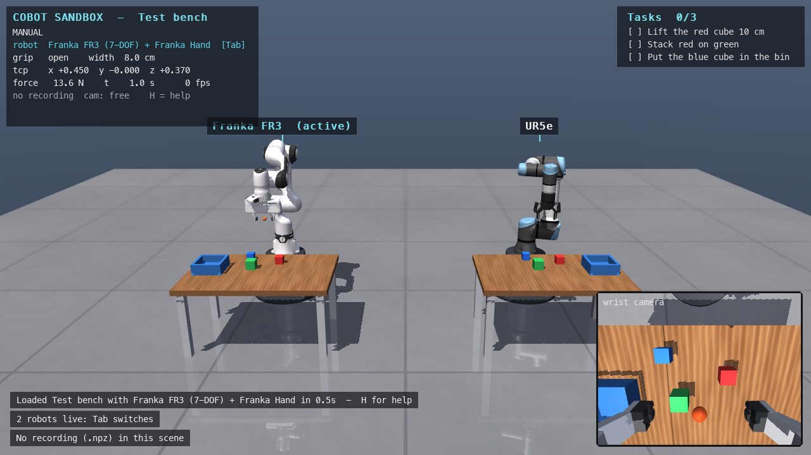

# Cobot Sandbox

[](https://github.com/shan-sherif/cobot-sandbox/actions/workflows/tests.yml)

A MuJoCo environment for robot-manipulation research with the two most common research cobots, the
**Franka FR3** (7-DOF, Franka Hand) and the **UR5e** (6-DOF, Robotiq 2F-85). Drive them with a
keyboard or gamepad, run scripted solvers and record demonstrations headless for imitation or
reinforcement learning, all through one action interface.

**Purpose: a research quick-start.** The goal is to let researchers start robot-learning work
immediately, in an environment that is easy to set up, read and modify, instead of spending weeks
building MuJoCo scenes, controllers, teleop and data pipelines first. Priorities: one-step setup,
reproducible data (bit-exact replay), standard research robots, scenes as short YAML files, and a
single action interface shared by teleop, scripts and learned policies. A separate, game-focused
spin-off lives in its own repository.



*Cobot Sandbox was written with the help of Claude Opus 5.5, and the result was checked manually.*

## Quick start

Needs Python 3.10 or newer (tested with 3.12). Works on macOS, Linux and Windows; the robot models
are included, so nothing else is downloaded.

**Option A: pip** (to use it)

```bash
pip install cobot-sandbox
cobot-sandbox                        # pick a scene, pick a robot, drive it. Press H in the window for help
```

Use a virtual environment as usual (`python -m venv .venv` first). The package is published to
PyPI from GitHub releases; until the first release, use option B.

**Option B: from source** (to read or change the code)

```bash
git clone https://github.com/shan-sherif/cobot-sandbox.git
cd cobot-sandbox
./setup.sh                 # macOS / Linux  (Windows PowerShell: py -3.12 install.py)
source .venv/bin/activate  # Windows: .venv\Scripts\activate
cobot-sandbox              # or: python run.py
```

`install.py` creates `.venv`, installs the repo there as an editable package (your code changes
apply immediately), and runs a quick check. `--dev` also installs pytest; `--check`
re-checks an existing setup. Getting Python: macOS `brew install python@3.12`, Ubuntu
`sudo apt install python3 python3-venv`, Windows [python.org](https://www.python.org/downloads/) or
`winget install Python.Python.3.12`.

**Commands** (both options): `cobot-sandbox` (the app), `cobot-sandbox-collect` (headless data
collection), `cobot-sandbox-replay` (inspect / verify recordings).
Each has `--help`. In a source checkout `python run.py` and `python scripts/*.py`
work too.

**Where your files go:** recordings (`data/episodes/`) and `settings.yaml` are kept in the repo folder for a source checkout, and in `~/cobot-sandbox/` for a
pip install. Set `COBOT_SANDBOX_HOME` to use another folder.

Other ways to start:

```bash
cobot-sandbox --list                          # scenes
cobot-sandbox --scene lift --robot ur5e       # straight to a scene with a robot (no menus)
cobot-sandbox --scene stack --policy task     # watch the scripted solver (any move key takes over)
cobot-sandbox --scene pick_place --randomize  # domain randomization on every reset (Backspace)
```

It runs with plain `python` on macOS (no `mjpython` needed), as well as on Linux and Windows.

### Headless Linux (servers, clusters, CI)

Physics, scripted policies and data collection without camera images need no display at all.
Rendering (camera images, `--cameras`, the app window) needs OpenGL; without a screen, tell MuJoCo
which off-screen backend to use:

```bash
export MUJOCO_GL=egl        # GPU machines (NVIDIA or Mesa drivers)
export MUJOCO_GL=osmesa     # CPU only; first: sudo apt install libosmesa6
cobot-sandbox-collect --scene lift --robot ur5e --episodes 100 --cameras wrist_cam
```

The interactive app needs a desktop session (or `SDL_VIDEODRIVER=dummy` for scripted screenshots).
The test suite runs on Linux, Windows and macOS on every push (badge above); tests that need
rendering skip themselves where no OpenGL is available.

## Scenes

| # | Scene | Robots | Recording |
|---|---|---|---|
| 0 | **Test bench**: FR3 and UR5e side by side, both live (**Tab** switches). Checklist: lift a cube, stack, put in bin. For trying things out. | both live | **off** (no `.npz`) |
| 1 | **Lift**: lift a cube 10 cm | pick one | on |
| 2 | **Stack**: red cube on green cube | pick one | on |
| 3 | **Pick and place**: four objects (cube, can, brick, block) into a bin | pick one | on |
| 4 | **Push**: push a cube onto a target with a closed gripper | pick one | on |
| 5 | **Peg insertion**: square peg into a hole, 4 mm clearance per side | pick one | on |

In scenes 1-5 a picker asks which robot to use when the scene loads (FR3 or UR5e); the choice is
remembered in `settings.yaml`, and **R** reopens it. Each scene defines
**tasks** with automatic success checks (shown as a checklist in the HUD, used by the autopilot,
data collection and `CobotEnv` rewards). Success means the goal was reached at some point, as in
robosuite.

Scenes 1-5 recreate the *layouts* of classic benchmark tasks (robosuite-style Lift, Stack,
PickPlace, plus Push and peg insertion) in this sandbox's own format; numbers are not directly
comparable to the original benchmarks. Importing real benchmark scenes (Franka Kitchen first) is on
the TODO list.

Measured with the scripted solver (`--policy task`), 10 randomized episodes per scene and robot:
**100 / 100 successful (FR3 and UR5e), no physics instabilities** (2026-11-09).

## Robots

| Robot | Joints | Gripper | Source |
|---|---|---|---|
| `franka_fr3` | 7 | Franka Hand | [MuJoCo Menagerie](https://github.com/google-deepmind/mujoco_menagerie), Apache-2.0 |
| `ur5e` | 6 | Robotiq 2F-85 | MuJoCo Menagerie, BSD-3-Clause (arm) / BSD-2-Clause (gripper) |

The robot models ship with this repo in `cobot_sandbox/assets/third_party/menagerie/`: an unmodified
subset of MuJoCo Menagerie at a pinned commit (only the files used, ~12 MB compressed), each
folder with its own `LICENSE` and `README.md`. They stay under their own licenses, not this repo's
MIT license; see [THIRD_PARTY_NOTICES.md](THIRD_PARTY_NOTICES.md). `python scripts/fetch_models.py`
re-creates the folder from upstream. To add another robot, write a YAML like these
(`source: menagerie`, or `source: xml` for a model file of your own).

All robots use the same controller (below) with their real joint and torque limits. Their built-in
position servos are replaced by torque motors driven by this sandbox's PD + gravity-compensation
loop, and every robot starts in the same home pose (TCP 45 cm in front of and 37 cm above its mount,
gripper pointing down), so scenes and scripts work unchanged across robots. Robot definitions are
YAML files in `cobot_sandbox/assets/robot/`; `scripts/robot_home.py` solves the home pose for a new one.

## Controls

| | Keyboard | Gamepad |
|---|---|---|
| Move gripper (TCP) | W/S forward/back, A/D left/right, R/F up/down | left stick, right stick ↕ |
| Rotate gripper | Q/E yaw, ↑/↓ pitch, ←/→ roll | right stick ↔, D-pad, LB/RB |
| Gripper open/close | Space | A |
| Arm home | Z | X |
| Precision (slow) | hold Shift | hold LT |
| Switch robot (Scene 0) | Tab | Y |
| Choose robot (scenes 1-5) | R | |
| Record demo | Enter (start/stop; off in Scene 0) | Start |
| Reset scene | Backspace | Back |
| Autopilot | P run/stop, O choose policy, any move key takes over | |
| Camera | drag orbit, right-drag pan, wheel zoom, C cycle cameras, T follow, V wrist view | |
| Misc | G labels on/off, L scene menu, `[` `]` next/prev scene, N randomization, K show contacts, F2 pause, H help, Esc quit | |

Gripper motions are in the **robot's base frame**: "forward" is always the direction the robot faces.

### Settings

Optional per-user settings go in `settings.yaml` (in the repo folder or `~/cobot-sandbox/`, see Quick start; not committed). Only the keys
you want to change are needed:

```yaml
show_labels: false     # floating text labels in the 3D view (default: true)
robot: ur5e            # robot preselected in the picker (the app saves your last choice here)
```

Command-line flags override the file for one run (`--labels` / `--no-labels`, `--robot`), and **G**
toggles labels in the app.

## Architecture

```
 Teleop (keyboard/gamepad) ─┐
 Scripted policies ─────────┼─► Command ─► Sim ─► TCP target (base frame) ─► diff-IK ─► joint targets
 Your policy / CobotEnv ────┤   (one 8-D       │      rate-limited ─► PD + gravity comp servo (1 kHz) ─► torques
 Replay of a recording ─────┘    action)       └─► tasks: lift / place / stack / push / insert checks
```

* **Robots** (`cobot_sandbox/assets/robot/<name>.yaml`, built by `cobot_sandbox/robots.py`): torque limits,
  servo gains, joint speed limits, following-error limits, TCP, wrist camera and gripper are
  explicit parameters. A scene can hold one robot (chosen by the user) or several live ones; the
  command goes to the active robot.
* **Action** (`cobot_sandbox/command.py`): 8 numbers, `ee_vx ee_vy ee_vz` (TCP velocity, m/s),
  `ee_wx ee_wy ee_wz` (TCP angular velocity, rad/s), both in the robot's base frame, `gripper`
  (0 open .. 1 closed) and `home` (> 0.5: move to the home pose). Recordings, `CobotEnv` and
  learned policies all use this format.
* **Scenes** (`cobot_sandbox/scenes/NN_<name>.yaml`) describe the environment: robot mounts (pedestals),
  tables, bins, holes, targets, objects, procedural clutter (`spawn:`), tasks, cameras and domain
  randomization. `scenes/_template.yaml` documents every option. A new file shows up in the app
  automatically, ordered by the number in its name (`02_stack.yaml` comes second after `01_lift.yaml`; the number only sets the order).
* **Tasks** (`cobot_sandbox/tasks.py`): `lift`, `place`, `stack`, `push`, `insert`, each a few lines of YAML.
* **Physics**: 1 ms timestep (1 kHz), 50 Hz control. At 2 ms, light objects piling up in a bin
  occasionally blew up with the Menagerie grippers; at 1 ms none did in the benchmark runs above.
* **Textures** are generated procedurally (`cobot_sandbox/textures.py`) and cached as PNGs in
  `cobot_sandbox/assets/textures/`. To use your own, drop in a PNG and set `material: my_texture`.

## Automation and data

```bash
# headless scripted demonstrations with domain randomization
cobot-sandbox-collect --scene lift --robot franka_fr3 --episodes 200 --dart 0.04
cobot-sandbox-collect --scene stack --robot ur5e --episodes 50 --cameras wrist_cam,front   # + images

cobot-sandbox-replay data/episodes/lift/franka_fr3/*.npz --verify   # inspect + check determinism
cobot-sandbox --replay data/episodes/lift/franka_fr3/<file>.npz         # watch an episode
```

* Each episode is one `.npz` file containing every observation (`obs/*`), the applied actions,
  optional camera images (`img/*`), goal info from scripted policies (`task/*`), the full initial
  simulator state (`init/*`) and metadata (scene, robot, seeds, randomization, rates). Replays are
  bit-exact, even for recordings started in the middle of a session.
* Episodes go to `data/episodes/<scene>/<robot>/`: robots have different joint counts, so keep
  their data apart.
* Human demos: press Enter in the app, perform the task, press Enter again (scenes 1-5).
* `--dart` adds correlated noise to the executed commands while saving the expert's clean labels.
  This is a standard trick that makes behavior cloning robust to its own mistakes.
* `cobot_sandbox/env.py` provides a Gymnasium-style `CobotEnv("lift", robot="franka_fr3")` (reset/step,
  normalized actions, optional image observations, sparse task-success reward) for RL or custom
  training loops.

### Training your own policies

The sandbox gives you the data and the environment; bring your own learning code (PyTorch, JAX,
LeRobot, robomimic, ...):

* **Imitation learning**: train on the recorded `.npz` episodes. Inputs are any `obs/*` (and
  `img/*`) keys; the targets are the 8-D actions. Train on one robot's folder at a time (joint
  counts differ). Scripted `task/*` goal info (object and place positions) is there if you want it.
* **Running a policy**: subclass `cobot_sandbox.policies.base.Policy` (an `act(obs, sim)` that
  returns a `Command`, see `policies/scripted.py`), or step `CobotEnv` from your own loop.
* Action chunking (ACT), diffusion policies, observation history and image inputs all work with
  this data. Export to the LeRobot / robomimic dataset formats is planned (see TODO).

## Sim-to-real: what this gives you, and what it doesn't

What's in place:
* A realistic control interface: Cartesian velocity commands over a joint servo with gravity
  compensation, plus joint speed, torque and following-error limits.
* Standard research robots with published kinematics and inertias (MuJoCo Menagerie).
* Contact physics tuned for stability, with an instability guard that resets cleanly and marks
  the episode as failed.
* Domain randomization (friction, mass, colors, lighting, object placement), observation noise
  (`Sim(obs_noise=...)`) and action latency (`Sim(action_latency=...)`).

What it doesn't give you: a simulator is only as reliable as its parameters. The servo gains here
are this sandbox's, not the manufacturers' controllers. Before trusting data or policies on a real
robot, do system identification: record real joint trajectories and tune `damping`, `armature`,
`frictionloss` and the gains until the sim reproduces them. Evaluate policies across the
randomization ranges, not only at the nominal values.

## Project layout

```
pyproject.toml             package definition (pip install cobot-sandbox; dependencies; commands)
install.py                 one-step source setup for macOS / Linux / Windows (setup.sh calls it)
run.py                     app launcher for a source checkout (= the cobot-sandbox command)
cobot_sandbox/
  cli.py                   the cobot-sandbox command (app launcher)
  tools/                   collect.py, replay.py (the cobot-sandbox-* commands)
  sim.py                   simulation core: per-robot control stack, observations, randomization, state save/restore
  robots.py                robot definitions -> MjSpec (Menagerie arm + gripper, motors, TCP, camera, sensors)
  scene_builder.py         scene YAML -> MuJoCo model (mounts, fixtures, objects, materials; attaches robots)
  tasks.py                 task success checks
  ik.py                    damped-least-squares differential IK
  command.py               the shared 8-D action (Command)
  teleop.py                keyboard + gamepad input
  app.py                   pygame window, cameras, HUD, recording; scene_menu.py, robot_picker.py
  recorder.py              episode format, loading, exact replay
  env.py                   Gymnasium-style headless environment
  settings.py, paths.py    per-user settings.yaml; where package and user files live
  policies/                scripted (task, pick_place, clear_table, push), replay
  assets/robot/            robot YAMLs (franka_fr3, ur5e); platforms/ (pedestal + shared visual style)
  assets/third_party/      bundled MuJoCo Menagerie models (THIRD_PARTY_NOTICES.md)
  scenes/                  00_test_bench, 01_lift, 02_stack, 03_pick_place, 04_push, 05_peg_insertion, _template
scripts/                   source-checkout wrappers + maintainer tools: fetch_models.py, robot_home.py,
                           export_scene.py
tests/test_smoke.py        end-to-end checks (python -m pytest -q tests)
.github/workflows/         tests.yml (Linux / Windows / macOS + wheel check), publish.yml (PyPI release)
```

## Development

For a source checkout set up with `python3 install.py --dev` (adds pytest), run these from the repo folder with
the `.venv` active:

```bash
python -m pytest -q tests                      # end-to-end tests (~10 s; rendering tests skip without OpenGL)
python install.py --check                      # re-check the setup without installing anything

# headless app smoke test: runs 60 frames and saves a screenshot, no window opens
SDL_VIDEODRIVER=dummy cobot-sandbox --scene lift --robot ur5e --frames 60 --screenshot out.png

# scripted benchmark check: success rate of the task solver for one scene and robot
cobot-sandbox-collect --scene stack --robot franka_fr3 --policy task --episodes 10 --out /tmp/bench

# robot models (normally not needed: the models are bundled)
python scripts/fetch_models.py                 # re-download the pinned Menagerie subset
python scripts/fetch_models.py --prune         # only drop files the robots don't load
python scripts/robot_home.py ur5e --write      # re-solve a robot's home pose into its YAML
```

**Adding a Menagerie robot:**
1. Add its folder to `FOLDERS` in `scripts/fetch_models.py` and re-run the script.
2. Write `cobot_sandbox/assets/robot/<name>.yaml` (copy `ur5e.yaml`), then run
   `scripts/robot_home.py <name> --write`.
3. Add its license to `THIRD_PARTY_NOTICES.md`.

## TODO

- [ ] Include special scenes from separate environments as scenes: e.g. the Franka Kitchen
      (Gymnasium-Robotics / RoboHive), RoboCasa kitchens, LIBERO tabletop scenes, MuJoCo Menagerie
      scenes, or levels made in the game spin-off. Load their MJCF/assets (bundled or fetched like
      the robot models, licenses kept), place our robot in them, and expose them through the
      same YAML scene format and 8-D action interface. Franka Kitchen first (needs articulated
      objects: doors, drawers, microwave).
- [ ] Export recordings to the LeRobot and robomimic dataset formats, so their ready-made policies
      (ACT, diffusion, ...) train on sandbox data directly. LeRobot first. (Do this before the
      endpoint below: it helps training the most.)
- [ ] Policy endpoint for evaluation: run a trained policy as its own server (any machine, GPU,
      framework or language) and let the sim connect to it, e.g.
      `cobot-sandbox --scene lift --policy-server ws://gpu-box:8000`, plus a headless
      `cobot-sandbox-eval` that reports success rates. Same pattern as openpi (websocket) and
      LeRobot async inference (gRPC); the same interface could later drive a real robot. Use
      msgpack + numpy arrays, never pickle. Not for RL: per-step network latency is too slow
      there; RL keeps using the in-process `CobotEnv` (vectorized envs could come later).

## Citing

If you use Cobot Sandbox in your research, please cite it (GitHub's **Cite this repository** button
gives the same, from [CITATION.cff](CITATION.cff)):

```bibtex
@software{tan_cobot_sandbox_2026,
  author  = {Tan, Shan Zheng},
  title   = {Cobot Sandbox},
  year    = {2026},
  version = {0.1.0},
  url     = {https://github.com/shan-sherif/cobot-sandbox},
  license = {MIT}
}
```

Please also cite [MuJoCo](https://github.com/google-deepmind/mujoco#citation) and
[MuJoCo Menagerie](https://github.com/google-deepmind/mujoco_menagerie#citing-menagerie), which
this project builds on.

## License

MIT. See [LICENSE](LICENSE). The bundled robot models keep their own licenses: see
[THIRD_PARTY_NOTICES.md](THIRD_PARTY_NOTICES.md).
